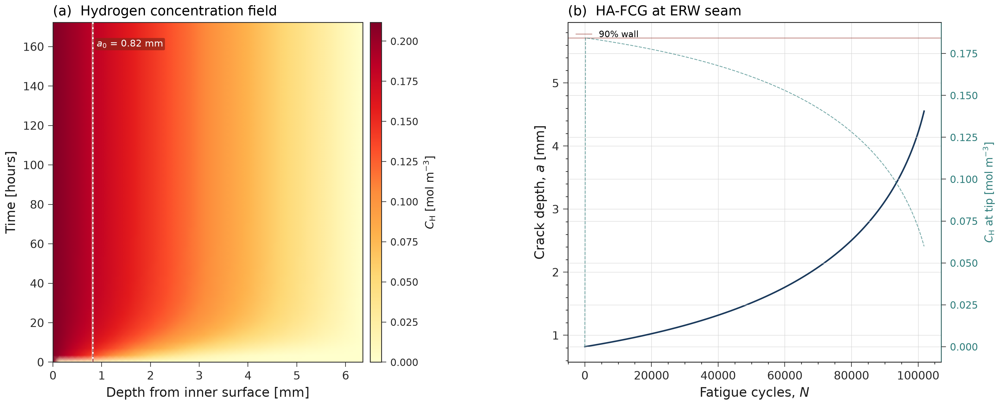
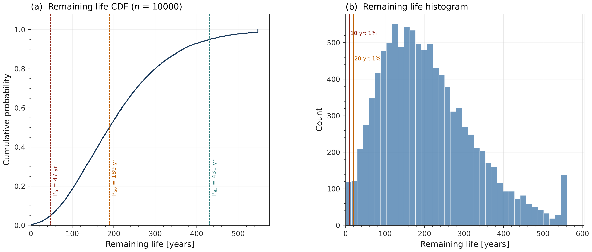

# INTEGRITY CODE SERIES — Week 7
## Hydrogen Conversion of Aging LF-ERW Pipeline: Coupled Diffusion-Fracture Life Prediction

[](https://github.com/felipearocha/integrity-code-series-week7-h2-lferw/actions/workflows/ci.yml)
[](LICENSE)
[](https://www.python.org/downloads/)
[](tests)
[](https://doi.org/10.5281/zenodo.20172481)

---

## Problem Statement

Can a 1959-vintage 20-inch API 5L X52 low-frequency ERW pipeline with pre-existing selective seam corrosion pits be safely converted from natural gas to hydrogen service?

This is the same pipe specification that failed at Willow River, Minnesota on January 16, 2026 (PHMSA Corrective Action Order, which identifies 20-inch 1959 API 5L X52 LF-ERW pipe).

ASME is developing a hydrogen chapter in B31.8, moving pipeline requirements out of B31.12.

## Key Results

From `python run_all.py`, with the default [ASSUMED] parameters. These are model outputs for a demonstration case, not a conversion assessment.

| Case | Result |
|------|--------|
| Default case, 0.82 mm pit, 7 MPa | Fracture at 101,801 cycles (279 years) |
| Monte Carlo, 10,000 samples | P5 = 47 yr, P50 = 189 yr, P95 = 431 yr |
| Fraction of samples below 10 yr | 0.8% |
| Surrogate on held-out LHS runs | R² = 0.997, MAE = 3.5 yr |

| LHS parameter (2,000 samples) | Spearman rho |
|-------------------------------|--------------|
| Hydrogen pressure | -0.83 |
| Initial pit depth | -0.43 |
| Seam toughness K_IC | +0.12 |
| Aspect ratio c/a | +0.03 |
| Diffusivity D_L | 0.00 |

Pressure dominates through the stress. Diffusivity has no influence: the wall reaches its steady hydrogen profile within days, while crack growth takes decades.

The fracture life above is not a safe life: see the FAD note in [Limitations](#limitations).





## Governing Equations

[**view the full rendered reference**](https://htmlpreview.github.io/?https://github.com/felipearocha/integrity-code-series-week7-h2-lferw/blob/main/docs/equations.html)

Every constant is tagged `[ASSUMED]` (requires experimental calibration) or is a published standard or physical-constant value. The physics is a 5-mechanism sequential chain; the full MathJax reference is in **[docs/equations.html](docs/equations.html)**.

**1. Hydrogen diffusion: Fick's law with a stress-drift term** (`src/hydrogen_diffusion.py`):

```math
\frac{\partial C_L}{\partial t} = D_L\,\frac{\partial^2 C_L}{\partial x^2} - D_L\,\frac{V_H}{RT}\,\frac{\partial}{\partial x}\left(C_L\,\frac{\partial \sigma_h}{\partial x}\right)
```

$C_L$ is lattice hydrogen in mol/m³, $D_L$ diffusivity in m²/s, $V_H$ partial molar volume in m³/mol, $\sigma_h$ hydrostatic stress in Pa, $x$ depth from the inner wall, $R$ the gas constant, $T$ temperature in K.

Sievert's-law inner-surface boundary condition, with wall thickness $w$ and $S$ in mol/(m³ MPa^0.5):

```math
C_L(0,t) = C_0 = S\sqrt{p_{H_2}}, \qquad C_L(w,t) = 0, \qquad C_L(x,0) = 0
```

**2. Pit growth at the ERW seam** (power law from prior NG service, `src/pit_to_crack.py`):

```math
a_{\text{pit}}(t) = k_{\text{pit}}\,f_{\text{seam}}\,t^{\,n_{\text{pit}}}
```

$a_{\text{pit}}$ is pit depth in m, $t$ service years, $f_{\text{seam}}$ the seam enhancement factor.

**3. Pit-to-crack transition** (Murakami $\sqrt{\text{area}}$ stress intensity range against the hydrogen-degraded threshold):

```math
\Delta K_{\text{pit}} = 0.65\,\Delta\sigma\,\sqrt{\pi\sqrt{\text{area}}}, \qquad \text{area} = \frac{\pi}{2}\,c\,a
```

```math
K_{th}(C_H) = \max\left[K_{th,\text{air}}\,\exp\left(-\lambda_{th}\,\frac{C_H}{C_{\text{ref}}}\right),\; K_{th,\min}\right]
```

$\Delta\sigma$ is the cyclic hoop stress range in MPa, $a$ pit depth, $c$ half-length, $C_H$ the hydrogen concentration at the tip. The pit becomes a crack when $\Delta K_{\text{pit}} \ge K_{th}$ or when $a$ reaches the El Haddad size:

```math
a_{th} = \frac{1}{\pi}\left(\frac{K_{th}}{F\,\Delta\sigma}\right)^{2}, \qquad F = 1.12
```

**4. Hydrogen-assisted fatigue crack growth** (modified Paris law, `src/ha_fcg.py`):

```math
\frac{da}{dN} = C_{\text{paris}}\,(\Delta K)^{m}\,\min\left[1 + \alpha_H\,(C_H/C_{\text{ref}})^{\beta_H},\; f_{\max}\right]
```

$N$ is cycles, $\Delta K$ in MPa√m, $f_{\max} = 50$ the cap on the enhancement. The stress intensity is $K = F\,\sigma\sqrt{\pi a}$ with

```math
F = 1.12\,\sqrt{\sec\left(\frac{\pi a}{2t}\right)}
```

where $t$ is the wall thickness.

**5. Failure criterion** (hydrogen-degraded toughness):

```math
K_{\max} \ge K_{IC}(C_H), \qquad K_{IC}(C_H) = \max\left[K_{IC,\text{air}}\,\exp\left(-\lambda_K\,\frac{C_H}{C_{\text{ref}}}\right),\; K_{IC,\min}\right]
```

**MAOP in the ASME B31.12 form** (`src/ha_fcg.py → maop_under_b3112`):

```math
P = \frac{2\,\text{SMYS}\,t\,F\,H_f}{D}
```

$D$ is outside diameter. $F = 0.50$ and $H_f = 0.54$ are **[ASSUMED]** placeholders, not read from the code book. Result: 2.42 MPa.

## Repository Structure

```
integrity-code-series-week7-h2-lferw/
    src/
        config.py                    # All parameters, [ASSUMED] flags
        hydrogen_diffusion.py        # 1D through-wall H diffusion PDE
        pit_to_crack.py              # Murakami SIF, transition criteria
        ha_fcg.py                    # HA-FCG + integrated life engine
        monte_carlo.py               # MC + LHS parametric sweep
        ml_surrogate.py              # GBR surrogate, feature ranking
        cybersecurity.py             # STRIDE, audit chain, sensor integrity
        visualization.py             # All plots + animated GIF
    tests/
        test_suite.py                # 191 tests
    docs/
        equations.html               # Rendered (MathJax) governing equations
    assets/                          # Generated visuals
    run_all.py                       # Full chain + all figures
    README.md
    requirements.txt
```

## Execution Order

```bash
# 1. Install dependencies
pip install -r requirements.txt

# 2. Run test suite (about 3 minutes)
python -m pytest tests/ -v

# 3. Smoke-run the whole chain: 20 MC + 60 LHS samples, figures to a temp folder (about 2 minutes)
python run_all.py --quick

# 4. Full run: 10,000 MC + 2,000 LHS samples, regenerates assets/ (about 30 minutes on 24 cores)
python run_all.py
```

## Key Assumptions Requiring Experimental Calibration

All parameters flagged [ASSUMED] in config.py. Critical ones:

- Sievert's constant S: governs surface hydrogen uptake
- Hydrogen embrittlement exponents (lambda_K, lambda_th): control property degradation rate
- HA-FCG enhancement parameters (alpha_H, beta_H): control crack growth acceleration
- ERW seam toughness K_IC and threshold K_th: must be measured on actual seam material in pressurized H2
- Seam enhancement factor f_seam: depends on specific manufacturing vintage
- Design factor F and performance factor H_f: placeholders in the MAOP

## Limitations

- **The stress-drift term is zero here.** For the Lamé field $\sigma_r + \sigma_\theta$ is constant through the wall, so $\sigma_h$ is uniform. The term is implemented and tested, but crack-tip stress is not modelled, so stress does not concentrate hydrogen in this package.
- **No trapping.** Only lattice diffusion is solved. `E_trap_kJmol` is a stored value that no equation uses.
- **Aspect ratio has little effect.** The stress intensity in the growth stage does not depend on $c/a$; it only enters the pit-to-crack check.
- **The default case runs above the MAOP.** 7 MPa is 78% of SMYS and 2.9 times the placeholder MAOP of 2.42 MPa. It is a stress case, not a proposed operating point.
- **Pits do not grow in hydrogen service.** Pit depth is fixed at conversion; only a crack grows.
- **Plastic collapse does not end the life calculation.** Life stops at $K_{\max} \ge K_{IC}$ or at 90% wall. The FAD trajectory of the default case leaves the envelope much earlier, at about 60,000 cycles (164 years), so the 279-year figure is a fracture life, not a safe life.
- **Life is capped.** Monte Carlo stops at 200,000 cycles (548 years) and the LHS sweep at 100,000 cycles (274 years).

## Cybersecurity (STRIDE)

7 threats documented (STRIDE + data poisoning). SHA-256 hash-chain audit logging.
Sensor spoofing detection for ILI data. Physics monotonicity check for training data
integrity. See `src/cybersecurity.py`.

## Escalation Table

| Dimension | Week 5 (MIC) | Week 6 (Galvanic) | **Week 7 (H2+LF-ERW)** |
|---|---|---|---|
| Physics coupling | Reaction-diffusion ODE | 2D Laplace + BV | **Transport PDE + fracture ODE** |
| Mechanism chain | Single (biofilm + acid) | Single (galvanic) | **5-mechanism sequential** |
| Probabilistic | Parametric sweep only | MCMC inverse | **Monte Carlo 10,000 + LHS** |
| Spatial | 1D chainage | 2D cross-section | **1D radial + through-wall** |
| Regulatory | None | None | **B31.12-form MAOP / PHMSA context** |

## Source Confidence Tiers

Every parameter in `config.py` is either a published standard or physical-constant value, or explicitly flagged `[ASSUMED]`. The tags follow three tiers:

- **T1 (standard, handbook, measured):** physical constants (Faraday, gas constant), API 5L X52 specification values (SMYS 358 MPa, SMTS 455 MPa), and the partial molar volume of H in Fe (literature consensus).
- **T2 (established closed-form derivations):** the Lamé thick-cylinder stress field, Barlow hoop stress, the Murakami √area surface-defect SIF, the El Haddad short-crack size, the simplified Newman-Raju surface-crack SIF, the Paris-law form, and the API 579-1/ASME FFS-1 Level 2 FAD curve as quoted in Bourga et al. 2016 (PVP2016-63876).
- **T3 (`[ASSUMED]` phenomenological fits requiring calibration):** the Sievert's constant S, lattice diffusivity D_L, the hydrogen-degradation exponents (lambda_K, lambda_th), the HA-FCG enhancement parameters (alpha_H, beta_H), the ERW-seam toughness and threshold values, the pit-growth constants (k_pit, n_pit, f_seam), and the MAOP factors F and H_f.

T3 values are marked `[ASSUMED]` at the point of use and must be measured in pressurized hydrogen before any engineering application.

## Disclaimer

Research tool only. Not for design, fitness-for-service, or safety-critical decisions
without site-specific calibration and independent PE review.

Not for production engineering decisions without experimental calibration of all
`[ASSUMED]` parameters. The hydrogen-degradation and HA-FCG enhancement functions are
phenomenological fits, not measured constants.

## License

MIT — Felipe Rocha. See [LICENSE](LICENSE).

## How to Cite

If this software contributes to your work, please cite both the software (this repository) and the underlying methods it implements.

**Software (archived release):**

> Rocha, F. (2026). *Integrity Code Series - Week 7 - Hydrogen Conversion of Aging LF-ERW Pipeline: Coupled Diffusion-Fracture Life Prediction* (Version 1.0.1) [Computer software]. Zenodo. https://doi.org/10.5281/zenodo.20172481

**BibTeX:**

```bibtex
@software{rocha_2026_week7,
  author       = {Rocha, Felipe},
  title        = {{Integrity Code Series - Week 7 - Hydrogen Conversion of Aging LF-ERW Pipeline: Coupled Diffusion-Fracture Life Prediction}},
  year         = 2026,
  publisher    = {Zenodo},
  version      = {v1.0.1},
  doi          = {10.5281/zenodo.20172481},
  url          = {https://doi.org/10.5281/zenodo.20172481}
}
```

| DOI | Points to |
|-----|-----------|
| [`10.5281/zenodo.20172481`](https://doi.org/10.5281/zenodo.20172481) (concept) | Always resolves to the latest version — use this for citation. |
| [`10.5281/zenodo.20172482`](https://doi.org/10.5281/zenodo.20172482) (version) | Pinned to v1.0.1 specifically — use when reproducibility matters. |

A machine-readable citation file is also available in [`CITATION.cff`](CITATION.cff) - GitHub will display a "Cite this repository" widget at the top right of the repo page that exports BibTeX / APA / RIS automatically.

## Integrity Code Series

Part of an ongoing series of physics-first integrity simulators by Felipe Rocha:

| # | Repo | Domain |
|---|---|---|
| Week 3 | [integrity-code-series-week3-f1-lap-simulation](https://github.com/felipearocha/integrity-code-series-week3-f1-lap-simulation) | F1 lap simulation (six-state model) |
| Week 6 | [integrity-code-series-week6-smartphone-galvanic](https://github.com/felipearocha/integrity-code-series-week6-smartphone-galvanic) | Smartphone galvanic corrosion (Laplace + Butler-Volmer) |
| **Week 7** | **[integrity-code-series-week7-h2-lferw](https://github.com/felipearocha/integrity-code-series-week7-h2-lferw)** | **LF-ERW H2 conversion (H diffusion + HA-FCG + B31.12-form MAOP) — this repo** |
| Week 8 | [integrity-code-series-week8-creep-fatigue-heater](https://github.com/felipearocha/integrity-code-series-week8-creep-fatigue-heater) | Creep-fatigue 9Cr-1Mo (Norton/Omega + Coffin-Manson) |
| Week 9 | [integrity-code-series-week9-cui](https://github.com/felipearocha/integrity-code-series-week9-cui) | CUI thermohygro-electrochemical (2 PDEs + Butler-Volmer, Strang) |
| Week 10 | [integrity-code-series-week10-nnph-scc](https://github.com/felipearocha/integrity-code-series-week10-nnph-scc) | NNpHSCC full-physics (Chen-Sutherby-Xing + BS 7910) |
| Week 11 | [integrity-code-series-week11-erosion-corrosion-multiphase](https://github.com/felipearocha/integrity-code-series-week11-erosion-corrosion-multiphase) | Erosion-corrosion multiphase (NORSOK M-506 + DNV-RP-O501 + G119 + API 579) |
